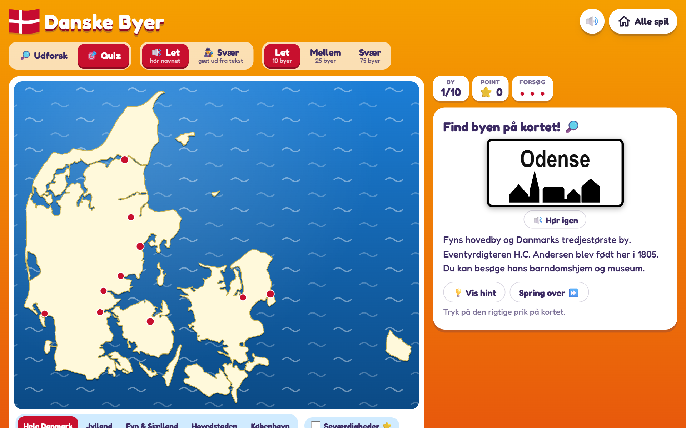

# Danske Byer (DanskeByer)


[](LICENSE)
[](https://github.com/kreaton/DanskeByer/stargazers)

⭐ If Danske Byer earns a place on your machine, [star it on GitHub](https://github.com/kreaton/DanskeByer) — it's free, made by one developer, and stars are how other people find it.



**A geography game for children: explore Denmark's 75 largest towns and its best-known sights, then find them on the map.**

▶️ **Play it:** <https://kreaton.github.io/KidsGames/danskebyer/>

It is a Blazor WebAssembly app (.NET 10) that runs entirely in the browser, with no server or backend. The game itself is in Danish.

## How to play

**🔎 Udforsk** (explore): tap a dot on the map. The town's road sign, population, rank, region, a photo and a short description appear, and the name is read aloud. Tick **Vis seværdigheder ⭐** to show 46 sights as stars, and **Vis bynavne** to show the town names.

**🎯 Quiz**: find the town on the map. You have three tries per town; a wrong dot tells you which way to go and how far (*"Byen du søger ligger mod sydvest herfra – ca. 105 km væk"*). **💡 Vis hint** gives the region and the part of the country, and **Spring over** shows the answer. A right answer plays a short chime, and the answer and the **Næste** button appear together at the top of the panel.

- **🔊 Let** (easy, the default): the name is shown on the road sign and read aloud, with the full description.
- **🕵️ Svær** (hard): only a description without the name; the name is said when the answer is revealed.
- **Seværdigheder ⭐** ticked: the quiz is about sights instead of towns, 10 picked at random from the 41 outside København in each round, and only those 10 stars are on the map. The København sights are left out because they lie too close together.

**Let / Mellem / Svær** at the top picks the 10, 25 or all 75 largest towns. The zoom buttons under the map show the whole country, Jylland, Fyn & Sjælland, Hovedstaden or København; the København view zooms right in on the inner city, with a detailed OpenStreetMap coastline.

The hint says *"i Jylland"* (a peninsula) but *"på Sjælland / Fyn / Bornholm / Lolland-Falster / Mors"* (islands), as Danish does.

## Sound

The town and sight names are spoken from `wwwroot/audio/` (made with Microsoft text-to-speech through edge-tts). A file is named after the name in lower case, with æ ø å as ae oe aa and anything else that is not a letter or digit as `_`, for example `H.C. Andersens Hus` → `h_c_andersens_hus.mp3`. 🔊/🔇 at the top turns the sound on and off (remembered in the browser), and **🔊 Hør igen** says the name again.

The voices are synthetic, and Microsoft requires that users are told so: the game says it at the bottom of the page and in the sound buttons' tooltips. The audio files may only be used in the game; they must not be published or shared as an audio dataset or used to train or improve speech or voice models. See [THIRD-PARTY-NOTICES.md](THIRD-PARTY-NOTICES.md) and `wwwroot/audio/README.txt`.

## Data

| File (`src/DanskeByer/wwwroot/data/`) | Contents |
|---|---|
| `towns.json` | 75 towns: name, population, coordinates, region, part of the country, description, quiz clue without the name, Wikipedia title |
| `sights.json` | 46 sights, each linked to a nearby town |
| `denmark.json` | The outline of Denmark (Natural Earth, public domain) and the map projection |
| `details.json` | A detailed coastline of central København (© OpenStreetMap contributors, ODbL 1.0), drawn instead of the outline in the København view, with the credit under the map |

Populations are rounded (Danmarks Statistik BY1; towns 51–75 as of 1 January 2026). Towns in Greater København's suburban belt (for example Lillerød, Værløse and Dragør) count as part of København, so the map stays playable.

`python tools/gen_data.py src/DanskeByer/wwwroot/data [ne_countries.geojson]` writes `towns.json` and `sights.json` (edit the texts and coordinates there); the map outline is only rebuilt when the Natural Earth file is given. `tools/gen_detail.py` builds `details.json` from OpenStreetMap; the steps are at the top of the file.

The photos are looked up live on Wikipedia and shown only when the image is on Wikimedia Commons (free licence); each links to its article for the photographer and licence. Without internet the game works without photos.

## Project layout

```
DanskeByer.slnx
src/DanskeByer/
  Components/Game.razor       The page: modes, levels, map toolbar, explore and quiz panels
  Components/DenmarkMap.razor The SVG map with towns, sights and zoom views
  Components/TownCard.razor   Road sign, facts, photo and description of a town
  Components/SightCard.razor  The same for a sight
  Services/QuizEngine.cs      The quiz rules: questions, tries, direction hints, score
  Services/GameData.cs        Loads the JSON data
  Services/SoundService.cs    Spoken names and the sound setting
  Services/WikiImageService.cs  Free photos from Wikipedia / Wikimedia Commons
  wwwroot/
    index.html                Host page, <base href>
    css/app.css               All styling and animations
    js/byer.js                Plays the names and the chime, saves the sound setting
    data/                     Towns, sights and map data
    audio/                    Spoken names (synthetic voice, not MIT)
    img/                      Road sign and the waving Dannebrog
    manifest.webmanifest
    icons/                    App icons and favicon
tools/make-icons.ps1          Draws the icons
tools/gen_data.py             Writes towns.json and sights.json
tools/gen_detail.py           Builds the København coastline from OpenStreetMap
```

## Running locally

Requires the [.NET 10 SDK](https://dotnet.microsoft.com/download).

```bash
dotnet run --project src/DanskeByer
```

Then open http://localhost:53006.

Stop the app before building it again. A running dev server keeps the list of files it started with, and after a rebuild the page can hang on loading.

## Publishing

Pushing to `main` builds the app and puts it in the `danskebyer/` folder of the KidsGames GitHub Pages site (<https://kreaton.github.io/KidsGames/danskebyer/>) with [`.github/workflows/deploy.yml`](.github/workflows/deploy.yml). It needs the repository secret `PAGES_DEPLOY_KEY`: the private half of a deploy key with write access to `kreaton/KidsGames`.

The app is served from a `danskebyer` sub-path: `<base href>` in [`wwwroot/index.html`](src/DanskeByer/wwwroot/index.html) is `danskebyer`.

The front page card is in `KidsGames/index.html`. `tools/make-icons.ps1 -FrontPageDir ..\KidsGames\billeder` copies the icon there.

## License & Authorship

This project is distributed under the terms of the [MIT License](LICENSE), except the files listed as not covered in [THIRD-PARTY-NOTICES.md](THIRD-PARTY-NOTICES.md): the spoken names in `wwwroot/audio/` and the OpenStreetMap-derived `details.json` (ODbL).

**AI authorship note:** Most of the source code in this repository was generated with AI coding agents (Claude Code), under my direction and review. Purely AI-generated material may not be eligible for copyright protection in some jurisdictions. To the extent any part of this project is protected by copyright, it is licensed under the MIT License, and the license's warranty and liability disclaimers apply to the project as a whole.

<!-- notices:start -->
### Independent development

Danske Byer is an independent, personal project developed by Per Hejndorf. It is not affiliated with, endorsed by or sponsored by Microsoft or any other rights holder (including Google, the Wikimedia Foundation, the OpenStreetMap Foundation and the LEGO Group). Product names and logos are trademarks of their respective owners and are used only to identify the services, tools and places the project works with.

### Third-party notices and asset provenance

[THIRD-PARTY-NOTICES.md](THIRD-PARTY-NOTICES.md) lists every third-party library, font, data source and online service the project uses, with version, licence, source and whether it was modified. It also records where the icons, images and audio came from and how they are licensed. A few assets are not covered by the MIT License; [THIRD-PARTY-NOTICES.md](THIRD-PARTY-NOTICES.md) marks them and states their terms.
<!-- notices:end -->
